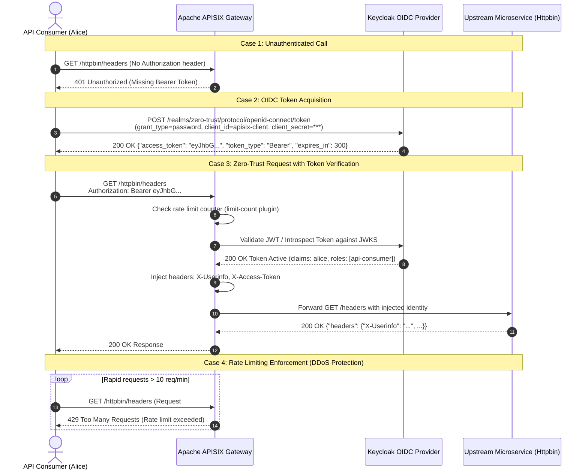

# Zero-Trust API Gateway: Apache APISIX & Keycloak on Kubernetes

[](https://github.com/zero-trust/apisix-keycloak-gateway/actions/workflows/ci.yml)
[](LICENSE)
[](https://kubernetes.io/)
[](https://apisix.apache.org/)
[](https://www.keycloak.org/)

A production-grade, GitOps-driven reference architecture implementing a **Zero-Trust API Gateway** perimeter using **Apache APISIX Ingress Controller**, **Keycloak (OIDC/OAuth2)** with a **PostgreSQL** database backend, enterprise-grade DDoS rate limiting (`limit-count`), and automated end-to-end integration tests on **KinD** (Kubernetes in Docker).

---

## 🏛 Architecture Overview

In a Zero-Trust architecture, **no perimeter is implicitly trusted**. Every incoming API request to the cluster is subjected to:
1. **DDoS Protection & Volumetric Throttling**: Checked at the edge before cryptographic operations (`limit-count` plugin).
2. **Cryptographic Identity Verification**: Token inspection against Keycloak OIDC Provider (`openid-connect` plugin in `bearer_only` mode).
3. **Identity Header Propagation**: Downstream user context (`X-Userinfo`, `X-Access-Token`) injected into sanitized upstream requests.
4. **Namespace Isolation & Least Privilege**: Pod Security Standards (`baseline`/`restricted`) enforced across dedicated namespaces.

```mermaid
flowchart TD
    subgraph External_Traffic["Public & Ingress Edge"]
        Client["Client / API Consumer\n(curl / Postman / SPA)"]
        KeycloakClient["Auth Request\n(Password / Auth Code / CI)"]
    end

    subgraph KinD["Kubernetes Cluster (zero-trust-gateway)"]
        subgraph Ingress_Namespace["Namespace: ingress-apisix"]
            APISIX_Ingress["APISIX Ingress Controller\n(watches ApisixRoute & ApisixPluginConfig)"]
            APISIX_DP["Apache APISIX Data-Plane\n(Proxy Port 80 / 443)"]
            
            subgraph Plugin_Chain["APISIX Pipeline Execution"]
                P1["1. limit-count Plugin\n(DDoS Defense / 10 req/min)"]
                P2["2. openid-connect Plugin\n(bearer_only: true)"]
                P3["3. proxy-rewrite Plugin\n(Strip /httpbin prefix)"]
            end

            ETCD[("etcd Cluster\n(APISIX State Storage)")]
        end

        subgraph Keycloak_Namespace["Namespace: keycloak"]
            KeycloakPod["Keycloak 24 Server\n(OIDC Realm: zero-trust)"]
            PostgresDB[("PostgreSQL 16 DB\n(Persistent Volume Claim)")]
            KeycloakCM["ConfigMap\nrealm-export.json"]
        end

        subgraph Workload_Namespace["Namespace: demo-apps"]
            HttpbinPod["Upstream Microservice\n(httpbin Pods v1/v2)"]
        end
    end

    %% Flow connections
    Client -->|1. HTTP Request (No Token)| APISIX_DP
    APISIX_DP -->|2. Reject: 401 Unauthorized| Client

    KeycloakClient -->|3. POST /protocol/openid-connect/token| KeycloakPod
    KeycloakPod --> PostgresDB
    KeycloakPod -->|4. Return Signed JWT Bearer Token| KeycloakClient

    Client -->|5. GET /httpbin/headers + Bearer Token| APISIX_DP
    APISIX_DP --> P1
    P1 -->|Within Limit| P2
    P1 -->|Exceeded Limit| Reject429["Reject: 429 Too Many Requests"]
    P2 -->|Introspect / JWKS verify| KeycloakPod
    P2 -->|Valid Token & Inject Headers| P3
    P3 -->|Forward Sanitized Request| HttpbinPod
    HttpbinPod -->|200 OK + Payload| APISIX_DP
    APISIX_DP -->|200 OK Response| Client

    APISIX_Ingress -.->|Syncs CRDs| APISIX_DP
    APISIX_Ingress -.->|Reads state| ETCD
    KeycloakCM -.->|Auto-imported on boot| KeycloakPod
```

---

## 🔐 OIDC Authentication & Verification Sequence



---

## 📁 Repository Directory Structure

```text
.
├── .github/
│   └── workflows/
│       └── ci.yml                     # KinD integration testing & Helm lint pipeline
├── helm/
│   ├── apisix/
│   │   ├── Chart.yaml                 # APISIX Ingress umbrella chart
│   │   └── values.yaml                # Production values for APISIX & Ingress Controller
│   └── keycloak/
│       ├── Chart.yaml                 # Keycloak wrapper chart
│       └── values.yaml                # Keycloak + PostgreSQL backend configuration
├── k8s/
│   ├── base/
│   │   ├── namespaces.yaml            # Isolated namespaces with Pod Security Standards
│   │   ├── secrets.yaml.template      # Declarative secret templates for GitOps
│   │   ├── httpbin-upstream.yaml      # Sample upstream microservice deployment & service
│   │   ├── apisix-plugin-config.yaml  # Reusable ApisixPluginConfig (rate-limit, cors)
│   │   └── apisix-route-httpbin.yaml  # ApisixRoute CRD with openid-connect & rewrite
│   └── kustomization.yaml             # Kustomize entrypoint
├── keycloak/
│   └── realm-export.json              # Auto-bootstrapped realm, client, and test users
├── scripts/
│   ├── setup-kind.sh                  # Creates KinD cluster with ingress port bindings
│   ├── deploy.sh                      # One-click deployment script
│   ├── test-oidc-flow.sh              # Automated curl verification test runner
│   └── teardown.sh                    # Teardown KinD environment
├── kind-config.yaml                   # KinD cluster spec mapping port 80 & 443
├── Makefile                           # Developer automation targets
└── README.md                          # Architecture, deployment & testing documentation
```

---

## 🚀 Quickstart & Prerequisites

### Prerequisites
- [Docker](https://docs.docker.com/engine/install/) 24.0+
- [kubectl](https://kubernetes.io/docs/tasks/tools/) v1.28+
- [Helm](https://helm.sh/docs/intro/install/) v3.12+
- [KinD](https://kind.sigs.k8s.io/docs/user/quick-start/) v0.22+
- `curl` and `jq`

### 1. Provision the KinD Cluster
```bash
make kind-up
# OR: ./scripts/setup-kind.sh
```

### 2. Deploy Infrastructure via GitOps
```bash
make deploy
# OR: ./scripts/deploy.sh
```
This script will:
- Create isolated namespaces (`ingress-apisix`, `keycloak`, `demo-apps`).
- Provision Kubernetes Secrets without exposing plaintext in version control.
- Create the Keycloak auto-import ConfigMap containing `realm-export.json`.
- Install Keycloak 24 with a persistent PostgreSQL database backend.
- Install Apache APISIX Ingress Controller with CRD support.
- Deploy the `httpbin` upstream service and apply `ApisixRoute` CRDs.

---

## 🧪 Testing the Zero-Trust Architecture via curl

### Automated Test Suite
To run the exact end-to-end test suite used in CI:
```bash
make test
# OR: ./scripts/test-oidc-flow.sh
```

### Manual Step-by-Step Verification

#### Step 1: Verify Perimeter Rejection (401 Unauthorized)
Attempt to call the protected API without providing credentials:
```bash
curl -i -H "Host: api.zerotrust.local" http://127.0.0.1/httpbin/headers
```
**Expected Response:**
```http
HTTP/1.1 401 Unauthorized
Content-Type: application/json; charset=utf-8
Server: APISIX/3.9.1

{"message":"Missing Bearer token or authorization header"}
```

#### Step 2: Acquire OIDC JWT Bearer Token from Keycloak
Request an access token for user `alice` using OAuth2 Direct Access Grants:
```bash
export ACCESS_TOKEN=$(curl -s -X POST \
  -H "Host: auth.zerotrust.local" \
  -H "Content-Type: application/x-www-form-urlencoded" \
  "http://127.0.0.1/realms/zero-trust/protocol/openid-connect/token" \
  -d "client_id=apisix-client" \
  -d "client_secret=apisix-oidc-client-super-secret-2026" \
  -d "grant_type=password" \
  -d "username=alice" \
  -d "password=Password123!" | jq -r '.access_token')

echo "Acquired Token: ${ACCESS_TOKEN:0:40}..."
```

#### Step 3: Call Protected API with Bearer Token (200 OK)
Pass the valid JWT to Apache APISIX:
```bash
curl -i -H "Host: api.zerotrust.local" \
  -H "Authorization: Bearer ${ACCESS_TOKEN}" \
  http://127.0.0.1/httpbin/headers
```
**Expected Response:**
```http
HTTP/1.1 200 OK
Content-Type: application/json
Server: APISIX/3.9.1
X-RateLimit-Limit: 10
X-RateLimit-Remaining: 9

{
  "headers": {
    "Accept": "*/*",
    "Host": "api.zerotrust.local",
    "X-Access-Token": "eyJhbGciOiJSUzI1NiIs...",
    "X-Userinfo": "{\"sub\":\"...\",\"preferred_username\":\"alice\",\"email\":\"alice@zerotrust.example.com\"}"
  }
}
```

#### Step 4: Verify DDoS Rate Limiting (429 Too Many Requests)
Execute a burst of 15 rapid requests:
```bash
for i in {1..15}; do
  curl -s -o /dev/null -w "Req #$i: HTTP %{http_code}\n" \
    -H "Host: api.zerotrust.local" \
    -H "Authorization: Bearer ${ACCESS_TOKEN}" \
    http://127.0.0.1/httpbin/headers
done
```
**Output:**
```text
Req #1: HTTP 200
Req #2: HTTP 200
...
Req #10: HTTP 200
Req #11: HTTP 429
Req #12: HTTP 429
```

---

## 🛡️ Production Security & Hardening Checklist

| Security Dimension | Implementation in this Repository | Production Guidance |
| :--- | :--- | :--- |
| **No Hardcoded Secrets** | `k8s/base/secrets.yaml.template` + `kubectl create secret` | Integrate HashiCorp Vault Agent or Bitnami SealedSecrets |
| **DDoS Mitigation** | `limit-count` plugin in `ApisixPluginConfig` | Configure Redis cluster backend for distributed rate limiting |
| **Zero-Trust Identity** | `openid-connect` with `bearer_only: true` | Enforce mTLS between Ingress and backend microservices |
| **Namespace Hardening** | Pod Security Standards `baseline` & `restricted` | Deploy Cilium / Calico NetworkPolicies to restrict pod egress |
| **High Availability** | 2x APISIX replicas, 1x etcd (scalable to 3), Postgres PVC | Multi-AZ deployment with PostgreSQL read replicas |
| **Observability** | Prometheus plugin enabled on APISIX routes | Forward APISIX metrics and Keycloak audit logs to Datadog/Grafana |

---

## 📄 License
Licensed under the Apache License, Version 2.0. See [LICENSE](LICENSE) for details.
